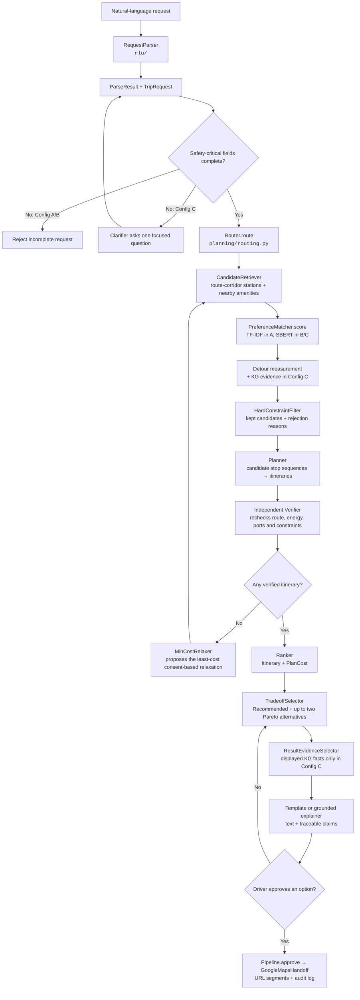

# Architecture

## Online pipeline (proposal Fig. 1) → code

Orchestration: `src/clickless/pipeline.py`. Configs choose implementations:

| config key | A | B | C |
|---|---|---|---|
| parser | rules | llm | llm |
| matcher | tfidf | sbert | sbert |
| retriever | corridor | corridor | corridor+kg |
| ranker | logreg | weighted | weighted+evidence |
| incomplete_request | reject | reject | clarify |
| explainer | template | template | grounded_llm (template + KG evidence) |
| selector (trade-offs) | tradeoff | tradeoff | tradeoff |

Planner, filters, verifier and the approval gate are identical in all configs (proposal Table II).

## Offline pipeline

`data/afdc.py`, `data/vehicles.py`, `data/osm_amenities.py` → normalized JSON in the fixture
layout → `data/snapshot/` + `MANIFEST.json` (hashes) → `retrieval/kg/build.py` → `kg.ttl`.

The KG ontology (`retrieval/kg/ontology.ttl`, v0.4) uses the namespace
`https://w3id.org/clickless#` (prefix `cc:`) for its terms and for the data IRIs `build.py` mints.
Its source-record, claim and explanation terms are aligned with PROV-O by one-way
subclass/subproperty axioms, and the stored graph holds no `prov:` triples (ADR 0019).

## Dependency rules (enforced by tests/review)

1. Modules talk only through `clickless.contracts` types and the Protocols in
   `contracts/interfaces.py`. `contracts/` imports nothing else from the project.
2. `evaluation.oracle` must not import `clickless.planning`, `clickless.ranking` or the pipeline.
3. Only `pipeline.py` knows which implementation is used; modules never import siblings'
   internals (e.g. `explain/` reads `PlanCost`, it does not call `ranking.cost`).
4. Numbers shown to the user come from contract fields, never recomputed in explanation code.
5. All randomness seeded; LLM temperature 0; prompts versioned; data frozen by hash; embedding
   models pinned by commit.

## Implementation status (Nov 26)

| Component | Status |
|---|---|
| contracts, configs, fixtures, DataStore, geo utils | done (contracts v0.5) |
| rules parser, multi-turn clarifier, priority phrases | implemented; Config A rejects incomplete requests while Config C keeps request-scoped clarification state (ADR 0014) |
| corridor retrieval | implemented: route-distributed, usable candidates with bounded per-stretch selection (ADR 0018) |
| TF-IDF matcher (A) | implemented: deterministic cosine similarity over shared amenity documents; fits the datastore vocabulary lazily once, reuses sparse document/query vectors, and returns 0 outside the requested category (ADR 0013, issue #156) |
| SBERT matcher (B, C) | Sentence-BERT cosine on the shared amenity documents (`retrieval/documents.py`); model pinned by commit in `configs/retrieval.yaml`, CPU, embeddings cached in `data/cache/sbert/`; other categories score 0 (category gate, ADR 0013) |
| cached router + detour | implemented: frozen route-cache lookup with measured route geometry; deterministic geometry remains the documented fallback where allowed |
| runtime OSRM routing | strict client, local cache, waypoint routing, verifier measurement, and temporary-failure fallback with user-visible estimate warnings implemented |
| energy model, charging-time estimate | v0 implemented |
| filters | v1: native connectors at any level + documented adapters at DC fast ports; a stated connector override only narrows (ADR 0012) |
| planner | v4 forward label-setting search with Pareto pruning, separate +15% consumption robustness, and comfort meal-stop top-ups to the pre-taper threshold |
| verifier | v3 independently replays SoC and validates station, connector, power, continuity, route-distance and detour claims; generated boundary tests cover tolerances and charge limits |
| weighted cost, trade-off selector | v1: B uses minutes-equivalent weighted cost; C additionally credits exact KG support for displayed station, selected-port and amenity facts (maximum configured in `tradeoffs.yaml`) |
| logreg ranker | standardized training, validation, save/load, probability ranking, and missing-model fallback implemented. Config A applies its documented positive-score amenity-credit floor before ranking; zero matches remain zero (ADR 0020). Final model awaits labeled DEV plans |
| template explainer, trade-off presenter | template explanation v0; natural, contract-grounded comparisons and KG-backed claims implemented |
| Maps URL + approval gate | segmentation done (3 waypoints per URL, ADR 0010) |
| harness | implemented: frozen split execution, independent planning oracle, request-understanding, grounding, ontology and trade-off metrics; final reports are still in progress |
| minimum-cost relaxation | integrated: penalty-ordered requests reuse the normal retrieve, filter, plan, verify, rank, and select path; changes require driver consent |
| curated vehicle loader | done: 15 vehicles, strict validation, per-field provenance (ADR 0009) |
| AFDC stations, OSM amenities, benchmark geocodes, snapshot build + manifest | done (ADR 0010, 0011); real snapshot built locally with `make snapshot-build` |
| KG build + enrichment (C) | ontology v0.4: final namespace and PROV-O alignment (ADR 0019). Runtime rdflib graphs contain only the current route's corridor candidates and amenities; full graphs remain available for offline competency queries. The pipeline copies facts for displayed normal or relaxed alternatives into `PlanResult.evidence` (ADR 0015, issue #115) |
| LLM parser, grounded explainer, evaluation splits/reporting | implemented; final Config A/B/C runs and report synthesis are still in progress |

Planner label/frontier primitives live in `planning/label_search.py`. Planning
tests are grouped by energy and charging, filtering, search, and verification
responsibility so each behavior has a focused place to evolve.

KG enrichment attaches facts to the same candidate objects that continue
through filtering and planning. After trade-off selection,
`planning/result_evidence.py` narrows that larger working set to facts about
stops and amenities that the driver is actually shown. It preserves
alternative, stop, and producer fact order while deduplicating by
`evidence_id`. The same boundary is used for the first successful relaxation;
facts from rejected candidates and failed relaxation attempts are not stored
in `PlanResult`.

Planner implementation responsibilities are also separated: `planner.py`
orchestrates nominal/robust runs and forward stop search,
`itinerary_simulation.py` constructs complete itineraries, and
`route_points.py` owns the shared distance, drive-time, and departure-charge
formulas used by both search and simulation.

Robust feasibility is evaluated through `ItineraryPlanner.plan_robust`. It
reuses the normal stop search and simulation with the frozen
`efficiency_penalty_robust` value. This sensitivity run may remove marginal
plans or require more stops, but ordinary pipeline planning continues to use
the nominal energy model.

Departure-charge targets come from `planning/charging_policy.py`. Balanced and
fastest profiles retain the just-enough target. At a stop that satisfies a
requested food preference, the comfort profile may charge to the existing
pre-taper threshold (80% in the committed energy model), capped by the maximum
departure SoC. Search and final simulation call the same policy.

Configuration A's `LogRegRanker` uses the five inputs listed by `FEATURE_NAMES`
in `ranking/logreg_ranker.py`. `extract_feature_values` produces values in that
same order. Training standardizes those features and fits the classifier as one
scikit-learn pipeline, then saves that complete pipeline with joblib so runtime
prediction applies the same preprocessing used during training.

The default artifact path is `results/models/logreg_a.joblib`. Generated results
are intentionally excluded from version control. When that artifact is absent,
the ranker explicitly delegates to `WeightedRanker`, and the pipeline reports the
fallback in its notes. The synthetic ranker tests verify this lifecycle; they do
not replace the real labeled DEV candidate plans needed to train the final model.
Held-out TEST labels must not be used for training or tuning.

Configuration A's verifier measurements remain deterministic geometric estimates,
not live road reroutes. All committed A/B/C configurations still select fixture
routing, so tests and demos remain offline and repeatable.

Planning can evaluate many stop sequences against one unchanged route. The
geometric measurer therefore retains the active route's geometry-wide values
and each authoritative station projection, while the planner calculates its
geometry-to-road-distance scale once and passes it to every final simulation.
A different route is checked before cached values are reused. Planner and
verifier still own separate measurer instances, so this reuse removes repeated
arithmetic without letting verification trust planner-produced measurements.

When routing mode is switched to OSRM, the pipeline injects a cache-backed
measurement strategy into the verifier. It independently requests each
consecutive itinerary leg and each single-station detour through the waypoint
router, rather than accepting distances copied from the planner.

OSRM mode now uses a cache-first wrapper. A request is identified by its ordered
coordinates and routing options. A cache hit returns a validated route labelled
`cached`; a miss calls the strict OSRM client, stores the validated runtime route,
and returns it. Cache files are generated under `data/cache/` and are excluded
from version control.

OSRM failures are now classified before routing policy handles them. Timeouts,
connection failures, and HTTP 5xx responses are temporary and eligible for
geometric fallback. `NoRoute`, invalid input, non-retryable HTTP responses,
malformed responses, and configuration errors are not fallback-eligible.

`TemporaryFailureFallbackMeasurer` applies that rule without weakening the
strict OSRM client. Successful measurements remain labelled `osrm`. Only an
`OSRMTemporaryError` delegates to the deterministic geometric measurer, records
`geometry_fallback` as the selected source, and creates an estimate warning.
The source and warning are reset for every attempt so a recovered service does
not retain stale fallback state. In OSRM mode, the shared pipeline now wraps the
cache-first verifier measurer with this policy and appends its warning exactly
once after final verification of the recommended plan. Cache-mode configurations
continue to use deterministic geometry directly and do not report an OSRM warning.

OSRM-mode candidate retrieval now uses the policy accepted in
`docs/decisions/0007-candidate-detour-fallback.md`. Individual temporary
station-reroute failures use the deterministic geometric detour estimate and
add one warning to the plan. The warning remains active across the complete
candidate collection, while cache mode and non-temporary OSRM errors retain
their existing behavior.

Final itinerary construction now follows the routed-leg decision accepted in
`docs/decisions/0008-routed-leg-itinerary-construction.md`. Forward search uses
inexpensive geometric estimates to propose stop sequences. Final simulation
then uses measured leg distances, measured driving durations, and measured stop
detours for energy, charging, and public itinerary fields. Planner and verifier
receive separate strategy instances so verification remains independent while
both can reuse the cache-first route provider.
